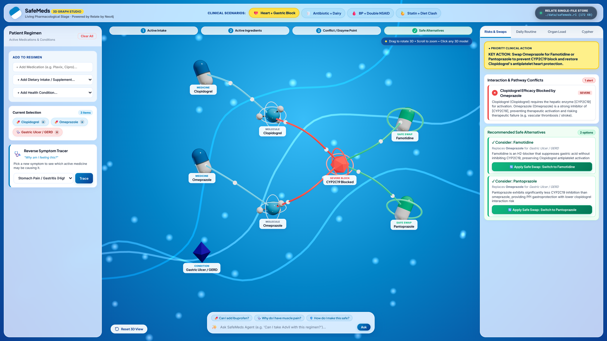
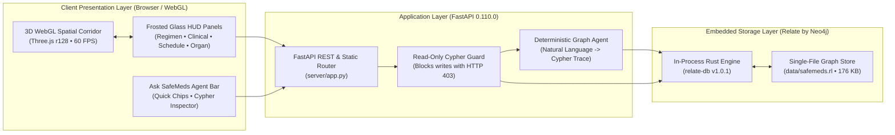
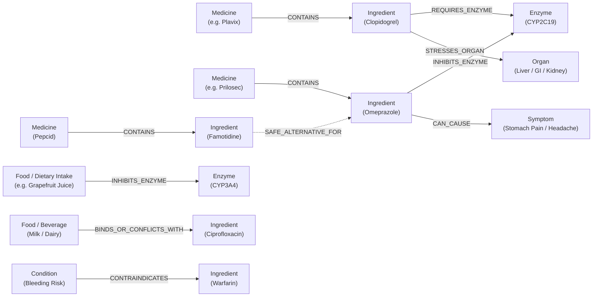
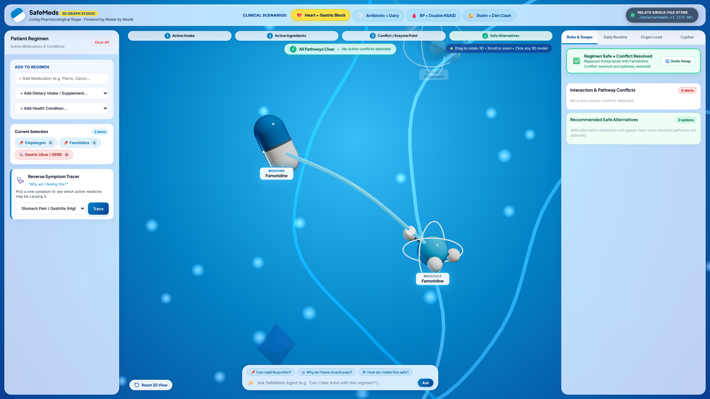
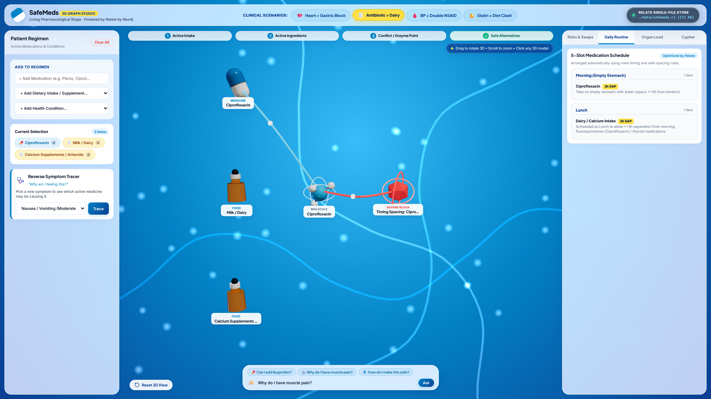

<div align="center">

# SafeMeds 3D Graph Studio
### Living Pharmacological Safety Stage & Multi-Hop Clinical Intelligence
**Built with Relate by Neo4j for the *"Context, Connected"* Hackathon**

[](https://huggingface.co/spaces/FOKRUL16/safemeds-3d-graph-studio)
[](https://relatedb.ai)
[](https://fastapi.tiangolo.com)
[](https://threejs.org)
[](https://www.python.org)
[](https://www.docker.com)
[](LICENSE)
[](https://youtu.be/PyQySB622IE)

<br/>

[](https://youtu.be/PyQySB622IE)

### [▶️ Click to Watch the 4K UHD 60fps Broadcast Demo on YouTube (1m 51s)](https://youtu.be/PyQySB622IE)

*Deterministic Bedside Pharmacological Intelligence &middot; 176 KB Single-File Graph &middot; Zero Cloud Latency &middot; Sub-9ms Cypher Traversal*

</div>

---

## 🩺 The Clinical Problem & Why Relate by Neo4j

Over **40% of older adults take 5 or more concurrent medications (polypharmacy)**. Adverse drug events cause over 1.3 million emergency room visits annually in the United States alone. Traditional clinical decision-support systems rely on **flat, pairwise lookup tables** that fail in real-world clinical practice:

1. **Pairwise Tables Miss Multi-Hop Collisions (3 to 4 Hops)**:
   - When a patient takes **Clopidogrel** (Plavix) alongside **Omeprazole** (Prilosec), pairwise tables often flag no direct chemical clash.
   - In human biology, the collision occurs 3 hops deep: `Clopidogrel` requires hepatic enzyme **`CYP2C19`** to convert from prodrug into active antiplatelet form, while `Omeprazole` strongly inhibits **`CYP2C19`**, completely neutralizing heart protection and leaving the patient vulnerable to fatal vascular thrombosis.
2. **Hidden Brand Overdose & Duplicate Ingredients**:
   - Patients unknowingly combine over-the-counter and prescription brands (e.g. Advil and Motrin, or Excedrin and Tylenol) containing identical active ingredients (`Ibuprofen` or `Acetaminophen`), multiplying organ toxicities.
3. **Food-Drug Chelation & Absorption Blocks**:
   - Common dietary items (milk, calcium supplements) chelate fluoroquinolone antibiotics like **Ciprofloxacin**, reducing GI bioavailability by up to 85% unless strictly spaced by 3 or more hours.
4. **Cloud Latency & Privacy Barriers in Clinical Environments**:
   - Rural emergency departments, field clinics, and private patient tablets cannot depend on remote cloud databases or expensive external APIs for life-critical drug interaction queries.

### The Solution: In-Process Relate Graph Engine

SafeMeds embeds the **Relate by Neo4j** Rust-powered graph engine directly into the application process via a single portable file: [`./data/safemeds.rl`](data/safemeds.rl) (**~176 KB**).

| Capability | Legacy Relational / Pairwise Tables | SafeMeds (Relate by Neo4j Single-File Store) |
| :--- | :--- | :--- |
| **Data Storage** | Heavy external SQL/NoSQL servers | **176 KB single-file database (`./data/safemeds.rl`)** |
| **Query Latency** | 120ms – 800ms (network + cloud roundtrips) | **< 9ms deterministic in-process Rust traversal** |
| **Multi-Hop Traversal** | Expensive multi-table SQL `JOIN` cascades | **Native openCypher graph pattern matching** |
| **Offline Privacy** | Requires streaming patient data to remote cloud | **100% offline-first; zero patient telemetry** |
| **Deployment** | Multi-container clusters & cloud provisioning | **Clone and run immediately (Zero setup)** |

---

## 🏛️ System Architecture

SafeMeds connects a high-performance **Three.js WebGL 3D spatial stage** with an **in-process Relate graph engine** guarded by read-only AST safety validation.



---

## 🧬 Pharmacological Knowledge Graph Schema

The SafeMeds knowledge graph models **53 medications**, **25 active ingredients**, **5 hepatic CYP450 enzymes**, **12 foods and supplements**, **10 chronic health conditions**, **15 adverse symptoms**, and **4 vital organ systems**.



---

## ✨ Core Clinical Capabilities

### 1. 4-Lane 3D Pharmacological Stage & Dynamic Framing
- Visualizes patient intake across 4 logical horizontal corridors:
  1. **Active Intake** (Medicine & dietary items represented as 3D pills and bottles)
  2. **Active Ingredients** (Extracted active molecules connected via bezier energy tubes)
  3. **Conflict & Enzyme Points** (Glowing red icosahedrons for metabolic collisions and contraindicated conditions)
  4. **Safe Alternatives** (Floating emerald capsules representing safe substitutes)
- Automatically computes bounding box geometry and dynamically adjusts Three.js camera distance and vertical offsets so 5-item polypharmacy regimens never clip outside the viewport.

### 2. Instantaneous One-Click Safe Swap & Undo
- When an enzyme block or drug clash is detected, SafeMeds queries `[:SAFE_ALTERNATIVE_TO]` pathways to identify therapeutic substitutes that avoid the offending pathway.
- Clicking **`Apply Safe Swap`** replaces the conflicting drug (e.g. Omeprazole with Famotidine), triggers an animated 3D dissolve, raises the top emerald **`All Pathways Clear • No active conflicts detected`** pill, and presents an instant **`Undo Swap`** capability.

### 3. Local "Ask SafeMeds Agent" with Sub-9ms Cypher Trace
- Enter clinical questions in natural language or tap quick chips (e.g. *"Why do I have muscle pain?"*, *"Can I add Ibuprofen?"*, *"How do I make this safe?"*).
- SafeMeds compiles the intent into deterministic openCypher queries executed against `./data/safemeds.rl` in **< 9.3ms**.
- Users can click **`Inspect Executed Cypher Query`** to review the exact parameterized Cypher query and execution timing.

### 4. Reverse Symptom Tracer ("Why Am I Feeling This?")
- Patients select newly developed symptoms (e.g. *Persistent Dry Cough*, *Swollen Ankles / Edema*, *Muscle Pain / Myopathy*).
- The engine traverses backwards along `(:Symptom)<-[:CAN_CAUSE]-(:Ingredient)<-[:CONTAINS]-(:Medicine)` to isolate the specific culprit medication in the active regimen (e.g. isolating Lisinopril for pulmonary bradykinin-induced dry cough).

### 5. 5-Slot Smart Daily Routine & Chelation Spacing
- Arranges daily intake across 5 physiological slots: **`Morning (Empty Stomach)`**, **`Breakfast`**, **`Lunch`**, **`Evening`**, and **`Bedtime`**.
- Evaluates `min_gap_hours` properties on `[:BINDS_OR_CONFLICTS_WITH]` relationships to insert required spacing badges (e.g. enforcing a 3-hour separation between Ciprofloxacin and dairy products to prevent calcium chelation).

### 6. Cumulative Vital Organ Load Meters
- Computes aggregated stress scores across **Kidney (Renal Clearance)**, **Liver (Hepatic Metabolism)**, **Stomach (Gastrointestinal)**, and **Brain (CNS)**.
- Flags dangerous cumulative toxicity (e.g. taking Lisinopril + Advil + Aleve triggers severe renal and gastrointestinal load warnings).

### 7. Production Hardening & Safety Guardrails
- **Read-Only Cypher Guard**: All write mutations (`CREATE`, `MERGE`, `DELETE`, `SET`, `DROP`) are blocked by strict AST keyword validation returning HTTP `403 Forbidden`.
- **Memory Disposal**: WebGL geometries, textures, materials, and requestAnimationFrame loops are systematically disposed on scene re-renders to prevent browser memory leaks.

---

## 🧪 4 Pre-Loaded Clinical Scenarios

| Scenario | Regimen & Conditions | Biological Pathway & Conflict | Relate Engine Safe Resolution |
| :--- | :--- | :--- | :--- |
| **💔 Heart + Gastric Block** | Clopidogrel + Omeprazole + Gastric Ulcer | Omeprazole inhibits hepatic `CYP2C19`, blocking Clopidogrel prodrug bioactivation into its antiplatelet form. | Recommends **Famotidine** (H2-blocker) or **Pantoprazole** (negligible CYP2C19 inhibition). |
| **🥛 Antibiotic + Dairy** | Ciprofloxacin + Milk / Dairy + Calcium | Divalent $Ca^{2+}$ cations chelate fluoroquinolones, reducing GI absorption by up to 85%. | Automatically schedules Ciprofloxacin in `Morning (Empty Stomach)` and Milk at `Lunch` (**3h Gap**). |
| **🩸 BP + Double NSAID** | Lisinopril + Advil + Aleve + Hypertension | Double NSAID therapy (Ibuprofen + Naproxen) causes renal vasoconstriction and blunts ACE-inhibitor antihypertensive efficacy. | Detects duplicate NSAID class, warns of GI bleeding, and suggests **Tylenol (Acetaminophen)** or **Losartan**. |
| **🍊 Statin + Diet Clash** | Atorvastatin + Warfarin + Grapefruit + Spinach | Grapefruit furanocoumarins irreversibly inhibit intestinal `CYP3A4` (spiking statin AUC by 400%), while Spinach $K_1$ blunts Warfarin. | Pinpoints rhabdomyolysis muscle breakdown hazard; recommends **Rosuvastatin** (eliminated via non-CYP3A4 pathway). |

---

## 📸 4K Visual Walkthrough Gallery

All 6 screenshots were captured natively at **3840×2160 (4K UHD)** using the automated Playwright capture suite in [`scripts/capture_screenshots.py`](scripts/capture_screenshots.py).

| #1 Hero: Heart + Gastric Block (Startup State) | #2 Live Safe Swap Resolved (Famotidine Activated) |
| :---: | :---: |
| [](docs/screenshots/01_hero_heart_gastric_block.png)<br/>*4-lane 3D graph, red CYP2C19 collision core, and yellow Priority Clinical Action banner.* | [](docs/screenshots/02_live_safe_swap_resolved.png)<br/>*Omeprazole replaced with Famotidine; emerald All Pathways Clear pill and Undo Swap card.* |
| **#3 Polypharmacy: Statin + Diet Clash (5-Item Graph)** | **#4 AI Graph Agent: Cypher Traversal & Explanation** |
| [](docs/screenshots/03_polypharmacy_statin_diet.png)<br/>*Atorvastatin, Warfarin, Grapefruit Juice, Spinach, and Bleeding Risk in 3D.* | [](docs/screenshots/04_ai_agent_cypher_trace.png)<br/>*Natural language query response with 3D node focus and live Cypher query inspection (<9ms).* |
| **#5 Antibiotic + Dairy: 5-Slot Daily Schedule** | **#6 BP + Double NSAID: Organ Load Dashboard** |
| [](docs/screenshots/05_antibiotic_dairy_daily_routine.png)<br/>*3h chelation timing gap between Ciprofloxacin and Dairy in the Daily Routine tab.* | [](docs/screenshots/06_nsaid_organ_load_dashboard.png)<br/>*Cumulative Kidney (10) and GI (8) organ stress meters with high strain clinical advisory.* |

---

## 🚀 Quick Start Guide

### Option 1: Local Python Setup (Recommended)

#### Prerequisites
- **Python 3.10+** (Tested on Python 3.11, 3.12, and 3.14)
- Google Chrome or Chromium (for full WebGL 3D rendering)

#### 1. Clone the repository:
```bash
git clone https://github.com/fokrulanthro16-eng/safemeds-3d-graph-studio.git
cd safemeds-3d-graph-studio
```

#### 2. Install dependencies:
```bash
pip install -r requirements.txt
```

#### 3. Run the automated verification test suite:
```bash
python verify_safemeds.py
```
*Expected Output:*
```text
=== TESTING SAFEMEDS AGAINST data/safemeds.rl ===
--- TEST 1: Heart + Gastric Block (Enzyme Collision & Safe Alternatives) ---
  Safe Alternatives Found: Pantoprazole, Famotidine
--- TEST 2: Antibiotic + Dairy Timing (Chelation & Spacing) ---
  Detected Food-Drug Conflict: Ciprofloxacin -> Milk / Dairy | Min Gap: 3 hrs
--- TEST 3: Blood Pressure + Double Painkiller (NSAIDs) + Organ Load ---
  Double-Dose Overlap Detected: Advil and Motrin contain Ibuprofen!
  Cumulative Organ Load: Kidney=10, Stomach/GI=8, Liver=2
--- TEST 4: Cholesterol + Blood Thinner + Diet Clash ---
  Atorvastatin vs Grapefruit Juice: Severe CYP3A4 inhibition
--- TEST 5: 5-Slot Daily Schedule Planner ---
  Planned Daily Routine: Morning, Breakfast, Lunch, Evening, Bedtime
ALL 5 CORE VERIFICATION TESTS PASSED SUCCESSFULLY!
```

#### 4. Run the security hardening test suite:
```bash
python scripts/test_hardening.py
```

#### 5. Launch the SafeMeds 3D Studio:
```bash
python -m uvicorn server.app:app --host 127.0.0.1 --port 8000
```
Open **`http://127.0.0.1:8000`** in your browser.

---

### Option 2: One-Command Docker Setup

Run SafeMeds in a fully isolated container with zero host dependencies:

```bash
docker compose up --build
```

The container automatically installs `relate-db`, mounts [`./data/safemeds.rl`](data/safemeds.rl), runs health checks against `http://127.0.0.1:8000/api/health`, and serves the 3D application on port `8000`.

To stop the container:
```bash
docker compose down
```

---

## 📂 Repository Project Structure

```text
safemeds-3d-graph-studio/
├── data/
│   └── safemeds.rl                     # Persistent single-file Relate by Neo4j graph (~176 KB, 53 meds)
├── docs/
│   └── screenshots/                    # 6 verified 4K UHD (3840x2160) submission screenshots
│       ├── 01_hero_heart_gastric_block.png
│       ├── 02_live_safe_swap_resolved.png
│       ├── 03_polypharmacy_statin_diet.png
│       ├── 04_ai_agent_cypher_trace.png
│       ├── 05_antibiotic_dairy_daily_routine.png
│       └── 06_nsaid_organ_load_dashboard.png
├── scripts/
│   ├── capture_screenshots.py          # Automated Playwright 4K screenshot suite
│   ├── generate_demo_video.py          # Broadcast video production pipeline (4K 60fps + neural voiceover)
│   ├── seed_data.py                    # Re-seeds the pharmacological knowledge graph into safemeds.rl
│   └── test_hardening.py               # Security tests verifying read-only Cypher guards (403 Forbidden)
├── server/
│   ├── __init__.py
│   └── app.py                          # FastAPI backend connecting to relate-db with REST & static routes
├── static/
│   ├── app.js                          # Client controller: Three.js r128 stage, bezier curves, HUD controller
│   ├── index.html                      # Semantic dashboard layout with frosted glass HUD panels
│   └── style.css                       # Pharmacy visual system (Sky-Blue, Royal Blue, Crisp White, Yellow)
├── .dockerignore                       # Docker build exclusions (docs, tests, virtualenvs)
├── .gitignore                          # Git exclusions (preserves data/safemeds.rl and screenshots)
├── docker-compose.yml                  # One-command Docker Compose orchestration
├── Dockerfile                          # Lean Python 3.11-slim production container
├── LICENSE                             # MIT Open-Source License
├── README.md                           # Comprehensive project documentation
├── requirements.txt                    # Project runtime dependencies
├── requirements-docker.txt             # Minimal container dependencies
└── verify_safemeds.py                  # Core standalone verification test suite
```

---

## 📜 Educational / Hackathon Prototype Disclaimer

> [!NOTE]
> **Clinical Hackathon Demonstration Disclaimer**  
> SafeMeds was designed and implemented as a technical demonstration and hackathon submission for the **Relate by Neo4j Hackathon (*Challenge: "Context, Connected"* )**. Pharmacological relationships, enzyme affinities, and safe alternative recommendations are modeled after published clinical literature (including FDA drug labels and CPIC guidelines) for demonstration purposes. SafeMeds does **not** constitute medical advice or a certified diagnostic device. Always consult a licensed physician, pharmacist, or healthcare provider for clinical prescription decisions.

---

## 📄 License

This project is licensed under the **MIT License** — see the [LICENSE](LICENSE) file for details.

Copyright &copy; 2026 **fokrulanthro16-eng**. Built with &hearts; for Relate by Neo4j.
